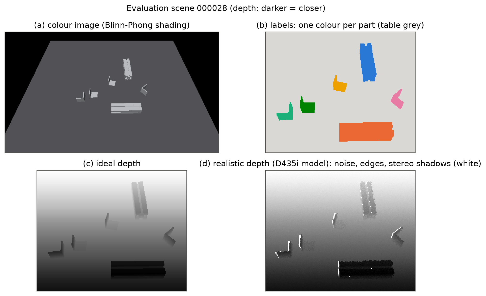

# Synthetic vs. real RGB-D data for aluminium profiles and brackets

Synthetic RGB-D scenes of aluminium profiles and brackets, a camera model of the Intel
RealSense D435i, and an experiment that measures how much the camera model changes the
results of two tasks, pose estimation and part/table segmentation.


- **Documentation** (pipeline details, checks, full result table): [`docs/documentation.md`](docs/documentation.md)
- **Camera parameters and their sources:** [`docs/camera_parameters.md`](docs/camera_parameters.md)

<p align="center"></p>

## Installation

Python 3.11. CPU only, no GPU needed.

```bash
git clone https://github.com/baldassarreFr/RGB-D_vision.git
cd RGB-D_vision
pip install -r requirements.txt
pip install -e .
```

Or with Docker:

```bash
docker build -t rgbd-vision .
docker run --rm -it -v "$PWD/outputs:/work/outputs" rgbd-vision bash
```

Quick test (one scene, saved and reloaded): `python checks/check_sample.py`.

## Reproducing the results

Run from the repository folder, in this order. Everything is written to `outputs/`.

**1. Data**

```bash
python scripts/generate_dataset.py --n 20 --start-seed 0  --out outputs/dataset        # tuning scenes
python scripts/generate_dataset.py --n 100 --start-seed 20 --out outputs/dataset_eval  # test scenes
python scripts/make_camera_variants.py --dataset outputs/dataset
python scripts/make_camera_variants.py --dataset outputs/dataset_eval
python scripts/make_camera_variants.py --dataset outputs/dataset --set step2
python scripts/make_camera_variants.py --dataset outputs/dataset_eval --set step2
```

**2. Pose estimation, Step 1**

```bash
python scripts/run_pose_experiment.py
python scripts/analyze_pose_experiment.py
```

**3. Pose estimation, Step 2**

```bash
python scripts/run_pose_experiment.py --set step2
python scripts/analyze_step2.py
```

**4. Segmentation**

```bash
python scripts/run_segment_experiment.py
python scripts/analyze_segment_experiment.py
```

**5. Example figures**

```bash
python scripts/make_figures.py
python scripts/make_seg_figure.py --seed 55
```

Each analysis script writes `analysis.txt` (all numbers), `analysis.json` and its figures,
which are also copied to `docs/figures/`.

## Results

| Folder | Content |
|---|---|
| `results/step1/` | Pose estimation with the camera model of Step 1 (conditions A, B, C and the ablation) |
| `results/step2/` | Pose estimation with holes and correlated noise, three strengths each |
| `results/segmentation/` | Part/table segmentation, conditions A, B, C and the ablation |

The three conditions are A (tuned on ideal depth, tested on ideal depth), B (tuned on
ideal, tested on realistic) and C (tuned on realistic, tested on realistic).

## Repository layout

| Folder | Content |
|---|---|
| `src/rgbd_sim/` | Parts, physics, rendering, camera model, pose estimation, segmentation, metrics |
| `scripts/` | Data generation, experiments, analyses, figures |
| `checks/` | Small scripts that check each module against values known in advance |
| `docs/` | Documentation, camera parameters, figures |
| `results/` | Results used in the report |
| `report/` | Report and one-page essay (PDF) |
